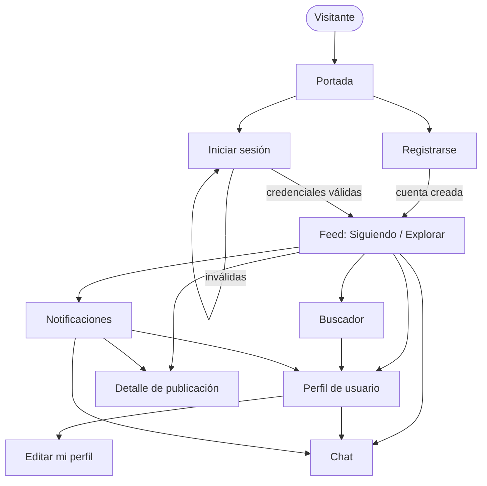
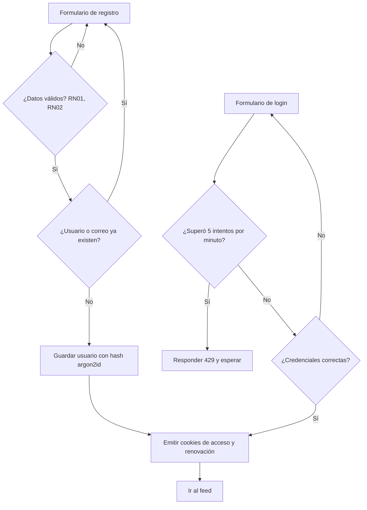
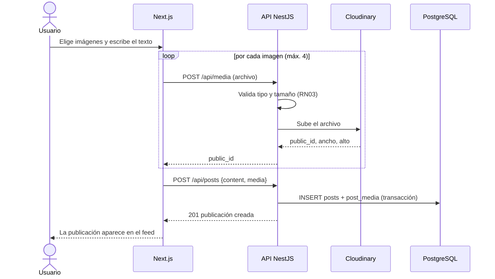
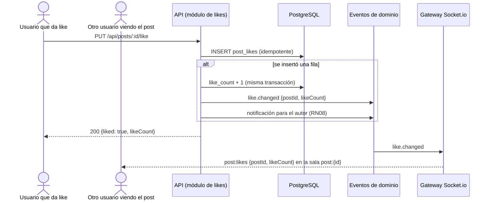
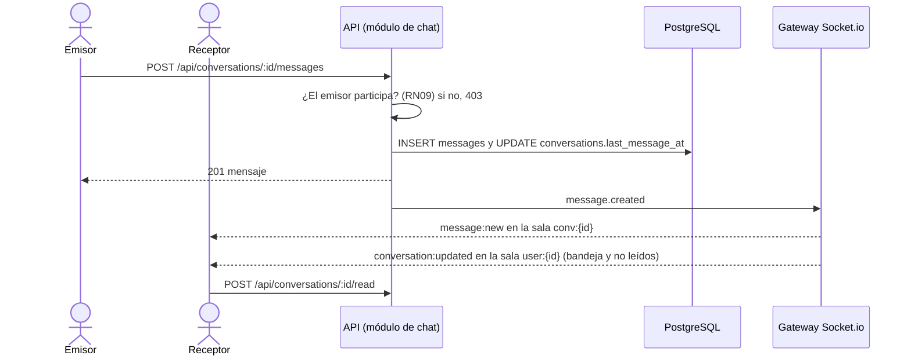

# Análisis del sistema

## Requerimientos funcionales

| ID | Requerimiento | Historias |
|---|---|---|
| RF01 | Registrar usuarios con usuario, correo y contraseña cifrada. | HU01 |
| RF02 | Iniciar y cerrar sesión, manteniendo la sesión entre visitas. | HU02 |
| RF03 | Mostrar solo la portada con acceso a login y registro a quien no tenga sesión. | HU03 |
| RF04 | Editar nombre visible, biografía y foto de perfil. | HU04 |
| RF05 | Mostrar el perfil de un usuario con sus publicaciones y contadores. | HU05 |
| RF06 | Crear publicaciones con texto, hasta 4 imágenes o ambos. | HU06 |
| RF07 | Eliminar publicaciones propias. | HU07 |
| RF08 | Mostrar el feed en dos pestañas: Siguiendo y Explorar, con carga progresiva. | HU08 |
| RF09 | Seguir y dejar de seguir usuarios. | HU09 |
| RF10 | Buscar usuarios por nombre de usuario o nombre visible. | HU10 |
| RF11 | Dar y quitar me gusta con contador actualizado en vivo. | HU11 |
| RF12 | Ver el detalle de una publicación, comentar, borrar comentarios propios y ver el contador de comentarios en vivo. | HU12 |
| RF13 | Notificar al instante likes, comentarios, seguimientos y mensajes, y conservarlas para consultarlas después. | HU13 |
| RF14 | Chatear 1 a 1 en tiempo real, con bandeja de conversaciones y mensajes no leídos. | HU14 |
| RF15 | Exponer la documentación interactiva de la API en `/api/docs`. | — |

## Requerimientos no funcionales

| ID | Categoría | Requerimiento |
|---|---|---|
| RNF01 | Rendimiento | Una página del feed responde en menos de 300 ms con los datos de prueba. La consulta del feed usa índices compuestos y paginación por cursor. |
| RNF02 | Renderizado | La portada se prerenderiza; feed, perfil y detalle se renderizan en el servidor con la sesión del usuario. |
| RNF03 | Seguridad | Contraseñas con argon2id, sesión en cookies `HttpOnly`, CORS limitado al dominio, validación estricta de entradas y límite de intentos de login. Detalle en el capítulo de seguridad. |
| RNF04 | Disponibilidad | Aplicación accesible por HTTPS en un dominio público. Cada despliegue verifica `/api/health` y vuelve a la versión anterior si falla. |
| RNF05 | Portabilidad | Todos los servicios corren en contenedores Docker; el entorno local y el de producción usan las mismas imágenes. |
| RNF06 | Mantenibilidad | TypeScript estricto en todo el código, lint y verificación de tipos obligatorios en CI, revisión de código antes de cada merge. |
| RNF07 | Usabilidad | Interfaz responsive, utilizable desde 375 px de ancho, con estados vacíos y mensajes de error claros. |
| RNF08 | Medios | Las imágenes se sirven desde el CDN de Cloudinary en formato y tamaño automáticos. |
| RNF09 | Recuperación | Respaldo diario de la base fuera del servidor, con restauración probada. |
| RNF10 | Documentación | API documentada con OpenAPI; sistema documentado en este documento, generado desde el repositorio. |

## Reglas de negocio

| ID | Regla |
|---|---|
| RN01 | El nombre de usuario tiene entre 3 y 30 caracteres (letras, números y guion bajo) y es único sin distinguir mayúsculas. El correo también es único sin distinguir mayúsculas. |
| RN02 | La contraseña tiene al menos 8 caracteres. Solo se guarda su hash argon2id. |
| RN03 | Una publicación tiene texto de hasta 2000 caracteres, al menos una imagen, o ambos. Máximo 4 imágenes jpeg, png o webp de hasta 5 MB cada una. |
| RN04 | Solo el autor puede eliminar su publicación o su comentario. La eliminación es lógica y las imágenes se borran de Cloudinary. |
| RN05 | Un usuario da como máximo un like por publicación. Repetir la acción no cambia el contador. |
| RN06 | Nadie puede seguirse a sí mismo. Seguir dos veces a la misma persona no crea un segundo registro. |
| RN07 | Un comentario tiene entre 1 y 1000 caracteres sin contar espacios iniciales y finales. |
| RN08 | Se notifica un like, un comentario, un seguimiento o un mensaje, nunca una acción sobre uno mismo. |
| RN09 | El chat es solo entre dos personas, con una única conversación por pareja. Solo sus participantes pueden leerla o escribir. Un mensaje tiene entre 1 y 2000 caracteres. |
| RN10 | Siguiendo muestra las publicaciones propias y las de los seguidos; Explorar muestra todas. Ambas en orden cronológico inverso, 20 por página. |
| RN11 | Sin sesión solo se accede a la portada, al login y al registro. |
| RN12 | La sesión usa un token de acceso de 15 minutos y uno de renovación de 7 días que se rota en cada uso. Reutilizar uno ya rotado cierra todas las sesiones del usuario. |
| RN13 | Se permiten 5 intentos de login por minuto por dirección IP. |
| RN14 | La búsqueda de usuarios requiere al menos 2 caracteres y devuelve como máximo 20 resultados. |

## Historias de usuario

<!-- HISTORIAS:INICIO (generado desde docs/plan/backlog.json; no editar a mano) -->

| ID | Historia | Origen |
|---|---|---|
| HU01 | Como visitante, quiero registrarme con usuario, correo y contraseña para tener una cuenta. | requisito |
| HU02 | Como usuario, quiero iniciar y cerrar sesión, y que mi sesión se mantenga al volver, para no ingresar mi contraseña cada vez. | requisito |
| HU03 | Como visitante sin sesión, quiero ver la portada de la red con el acceso al login y al registro; cualquier otra ruta me lleva a la portada. | decisión del equipo |
| HU04 | Como usuario, quiero editar mi nombre visible, mi biografía y mi foto de perfil. | imprescindible |
| HU05 | Como usuario, quiero ver el perfil de otra persona con sus publicaciones y sus contadores de seguidores, seguidos y publicaciones. | requisito |
| HU06 | Como usuario, quiero publicar texto, imágenes (hasta 4) o ambos. | requisito |
| HU07 | Como usuario, quiero eliminar mis propias publicaciones. | requisito |
| HU08 | Como usuario, quiero un feed con dos pestañas: Siguiendo (mis seguidos y yo) y Explorar (todas las publicaciones), con scroll infinito. | requisito |
| HU09 | Como usuario, quiero seguir y dejar de seguir a otras personas. | requisito |
| HU10 | Como usuario, quiero buscar personas por usuario o nombre para encontrar a quién seguir. | imprescindible |
| HU11 | Como usuario, quiero dar y quitar me gusta, y ver el contador actualizarse en vivo cuando otros reaccionan. | requisito |
| HU12 | Como usuario, quiero abrir una publicación, leer y escribir comentarios, borrar los míos y ver el contador de comentarios en vivo. | imprescindible |
| HU13 | Como usuario, quiero recibir notificaciones al instante cuando me dan like, me comentan, me siguen o me escriben, y verlas después si estaba desconectado. | imprescindible |
| HU14 | Como usuario, quiero chatear 1 a 1 con otra persona: ver mi bandeja con los mensajes no leídos y recibir los mensajes sin recargar. | imprescindible |

<!-- HISTORIAS:FIN -->

## Diagramas de flujo

### Navegación

### Registro e inicio de sesión

### Publicar con imágenes

### Like con contador en vivo

### Mensaje de chat

