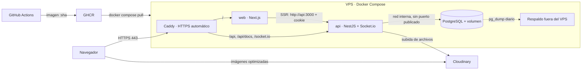
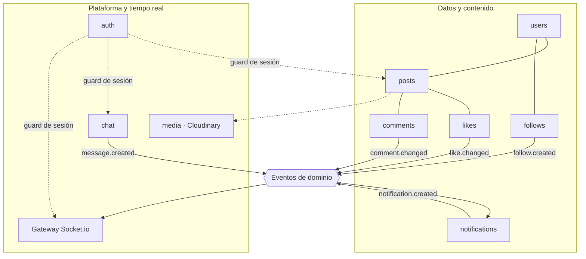
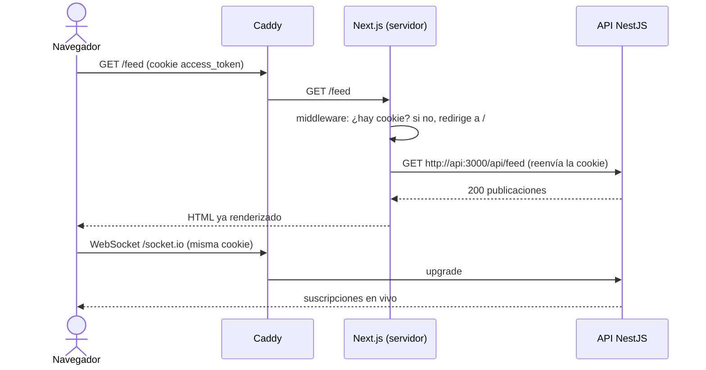

# Arquitectura

## Estilo arquitectónico

Arquitectura cliente-servidor con un **monolito modular** en el backend. Con tres desarrolladores y un mes de plazo, los microservicios agregarían comunicación entre servicios, despliegues múltiples y fallos distribuidos sin ningún beneficio a esta escala. Los módulos de NestJS mantienen los límites entre dominios dentro de un solo proceso.

## Diagrama de despliegue

Todo el sistema vive bajo **un solo dominio**: Caddy envía `/` a Next.js y `/api`, `/api/docs` y `/socket.io` a NestJS. Así la cookie de sesión pertenece al mismo sitio que la aplicación y no hay que configurar cookies entre dominios.

## Módulos del backend

Los módulos de contenido **no llaman al Gateway**: publican eventos con `@nestjs/event-emitter`, y el Gateway los escucha y los envía por socket. Ese contrato permite que Dev 2 y Dev 3 trabajen en paralelo y que cada lado se pruebe por separado.

### Eventos de dominio

Los tipos están en `apps/api/src/events/domain-events.ts`. Un servicio emite con `DomainEvents.emit('like.changed', datos)` y un listener escucha con `@OnDomainEvent('like.changed')`. Los dos están tipados: un nombre que no existe o datos que no corresponden no compilan. Las fechas viajan como `Date`; el Gateway las convierte a texto al enviarlas.

| Evento | Lo emite | Datos | Quién lo escucha |
|---|---|---|---|
| `like.changed` | Likes (S2-07), solo si el contador cambió | `{ postId, postAuthorId, actorId, change: "added" \| "removed" \| "changed", likeCount, topReactions }` | Gateway: `post:likes` a `post:{postId}`. Notificaciones: crea la de like si `change` es `added` |
| `comment.changed` | Comentarios (S3-01) | `{ postId, postAuthorId, actorId, commentId, change, commentCount }` | Gateway: `post:comments` a `post:{postId}`. Notificaciones: crea la de comentario si `change` es `added` |
| `follow.created` | Seguimiento (S2-06), solo si se creó la fila | `{ followerId, followingId }` | Notificaciones |
| `message.created` | Chat (S3-04) | `{ message: Message, recipientId }` | Gateway: `message:new` a `conv:{conversationId}` y `conversation:updated` a los dos participantes. Notificaciones |
| `conversation.read` | Chat (S3-06) | `{ conversationId, userId, readAt }` | Gateway: `conversation:read` a `conv:{conversationId}` |
| `notification.created` | Notificaciones (S3-03) | `{ recipientId, notification: Notification }` | Gateway: `notification:new` a `user:{recipientId}` |

Reglas:

- Se emite **después** de confirmar la transacción, nunca dentro de ella: así nadie avisa de un cambio que terminó deshaciéndose.
- Repetir un `PUT` idempotente (like o seguir) no emite nada, porque no cambió nada (RN05, RN06).
- Quien escucha decide si actúa: notificaciones ignora los eventos en que `actorId` es el mismo destinatario (RN08).
- Si un listener lanza un error, se registra en el log y no le llega a quien emitió: un fallo al notificar no tumba la petición del usuario.
- Los listeners asíncronos terminan después de que la petición respondió. La notificación de un like, por ejemplo, aparece unos milisegundos después del 200; las e2e la esperan en vez de suponer que ya está (`test/notifications.e2e-spec.ts`).
- Un evento nuevo se agrega a `DomainEventMap` y a esta tabla en el mismo PR.

## Renderizado en el servidor con sesión

## Tiempo real

| Sala | Quién entra | Eventos que recibe |
|---|---|---|
| `user:{id}` | Cada usuario al conectarse, con todas sus pestañas (S1-04) | `notification:new`, `conversation:updated` |
| `post:{id}` | Clientes con esa publicación en pantalla | `post:likes`, `post:comments` |
| `conv:{id}` | Participantes de la conversación, verificados al unirse | `message:new`, `conversation:typing`, `conversation:read` |
| `presence:{id}` | Quien tiene una conversación con ese usuario y envió `presence:watch` (S3-06) | `user:presence` |

El Gateway valida la cookie en el handshake con el mismo `SessionTokenService` que el guard HTTP y cierra el socket cuando vence el JWT, así un logout o el cierre de sesiones de RN12 llega al socket en 15 minutos como máximo. `session:ready` se envía solo al socket que se conecta, no a la sala.

Los mensajes de chat se envían por REST (`POST /api/conversations/:id/messages`) y se distribuyen por socket. Así se validan con los mismos DTOs, quedan documentados en Swagger y se prueban con Supertest.

El backend corre en **una sola instancia**. Para escalar a varias haría falta el adaptador de Redis para Socket.io; queda registrado como deuda técnica.

## Stack tecnológico

| Capa | Tecnología | Motivo |
|---|---|---|
| Frontend | Next.js (App Router), React, TypeScript | SSR y prerenderizado nativos; el equipo domina el ecosistema Node. |
| Backend | NestJS, TypeScript | Módulos e inyección de dependencias, DTOs con `class-validator`, Swagger por decoradores y Gateway de WebSockets integrados. |
| Tiempo real | Socket.io | Salas, reconexión automática e integración con NestJS. |
| Base de datos | PostgreSQL 16 | Relacional, con `citext`, `pg_trgm`, restricciones `CHECK` e índices parciales. |
| ORM | Prisma | Esquema declarativo, migraciones versionadas y tipos generados. |
| Imágenes | Cloudinary | Optimización y redimensión automáticas servidas por CDN. |
| Proxy y HTTPS | Caddy | Certificados automáticos y WebSockets sin configuración adicional. |
| Contenedores | Docker, Docker Compose | El mismo artefacto en local y en producción. |
| CI/CD | GitHub Actions, GHCR | Integrado con el repositorio; imágenes versionadas por commit. |
| Gestión | GitHub Issues, Projects y Milestones | Tareas, tablero y avance junto al código. |
| Documentación | Markdown y Mermaid en `docs/`, Swagger en `/api/docs` | Versionada con el código; el PDF se genera desde aquí. |

## Decisiones de arquitectura

| # | Decisión | Alternativa descartada | Motivo |
|---|---|---|---|
| D01 | Monolito modular | Microservicios | Complejidad operativa sin beneficio a esta escala. |
| D02 | Un dominio con rutas | Subdominios para web y API | Cookies del mismo sitio, sin CORS para el navegador. |
| D03 | Sesión en cookies `HttpOnly` con refresh rotado | JWT en localStorage | El token no queda expuesto a XSS. |
| D04 | Subida de imágenes a través del backend | Subida firmada directa | Más simple para un mes; la validación vive en un solo lugar. |
| D05 | Contadores desnormalizados en `posts` | `COUNT(*)` en cada consulta | Valor listo para emitir en vivo y feed sin agregaciones. |
| D06 | Imágenes construidas en CI y publicadas en GHCR | Compilar en el VPS | Lo que se despliega es lo que CI probó; permite volver atrás por etiqueta. |
| D07 | Caddy | Nginx con Certbot | HTTPS automático y menos configuración. |
| D08 | Eventos de dominio entre módulos | Llamadas directas al Gateway | Desacopla el trabajo de Dev 2 y Dev 3. |
| D09 | Sin contenido público | Perfiles públicos | Decisión del equipo; simplifica permisos y consultas. |
| D10 | Notificaciones y chat como paneles verticales a la mitad de pantalla (lado derecho), cada uno independiente, en vez de páginas completas separadas | Páginas completas independientes para /notificaciones y el chat | Decisión del equipo (S3-07, S3-06): permite abrir uno sin perder el feed de fondo y deja reservada la otra mitad para el otro panel. |
