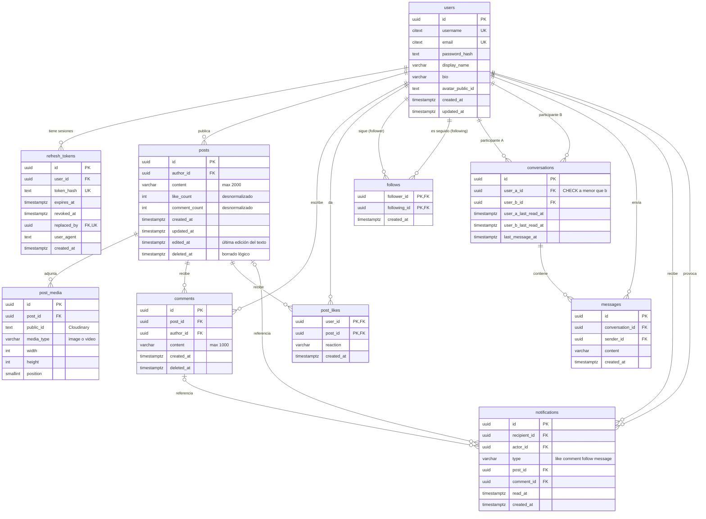

# Base de datos

## Criterios de diseño

- **Tercera forma normal**, con una única desnormalización deliberada: los contadores `like_count` y `comment_count` en `posts`, actualizados en la misma transacción que el like o el comentario (decisión D05).
- **La base impide los datos inválidos**, no solo la aplicación: restricciones `UNIQUE`, `CHECK` y claves foráneas con comportamiento de borrado definido.
- **Índices diseñados para las consultas reales**: el feed, el perfil, los comentarios de una publicación, los mensajes de una conversación y las notificaciones sin leer.
- **Paginación por cursor** `(created_at, id)` en todas las listas largas; nunca `OFFSET`. En `follows`, que no tiene `id`, el desempate es el id del otro usuario. El cursor guarda `created_at` con sus microsegundos (`apps/api/src/common/pagination.ts`): un `Date` de JavaScript solo llega a milisegundos y haría saltar las filas creadas en el mismo milisegundo, así que las listas leen esa columna con `$queryRaw`.
- Nombres de tablas en plural y minúsculas (`users`, `post_likes`) para evitar palabras reservadas de SQL como `user` y `like`.
- Identificadores UUID v7 (ordenables por tiempo) y fechas `timestamptz`.

El esquema vive en `apps/api/prisma/schema.prisma`. Lo que Prisma no puede expresar (extensiones, `CHECK`, índices parciales y de trigramas) se agrega a mano en el SQL de la migración; la referencia completa está en `docs/plan/schema_referencia.sql`.

## Diagrama entidad-relación



## Diccionario de datos

### users

| Columna | Tipo | Restricciones | Descripción |
|---|---|---|---|
| id | uuid | PK | Identificador (UUID v7). |
| username | citext | NOT NULL, UNIQUE, CHECK `^[A-Za-z0-9_]{3,30}$` | Nombre de usuario, único sin distinguir mayúsculas (RN01). |
| email | citext | NOT NULL, UNIQUE | Correo, único sin distinguir mayúsculas. |
| password_hash | text | NOT NULL | Hash argon2id (RN02). |
| display_name | varchar(80) | | Nombre visible. |
| bio | varchar(300) | | Biografía. |
| avatar_public_id | text | | Identificador de la foto en Cloudinary. |
| created_at, updated_at | timestamptz | NOT NULL | Auditoría. |

### refresh_tokens

| Columna | Tipo | Restricciones | Descripción |
|---|---|---|---|
| id | uuid | PK | |
| user_id | uuid | FK users, ON DELETE CASCADE | Dueño de la sesión. |
| token_hash | text | NOT NULL, UNIQUE | Hash del token; nunca se guarda en claro. |
| expires_at | timestamptz | NOT NULL | Vencimiento (7 días, RN12). |
| revoked_at | timestamptz | | Fecha de rotación o cierre. |
| replaced_by | uuid | FK refresh_tokens, UNIQUE, ON DELETE SET NULL | Token que lo reemplazó; permite detectar reutilización. |
| user_agent | text | | Navegador que abrió la sesión. |
| created_at | timestamptz | NOT NULL | |

### posts

| Columna | Tipo | Restricciones | Descripción |
|---|---|---|---|
| id | uuid | PK | |
| author_id | uuid | FK users, ON DELETE CASCADE | Autor. |
| content | varchar(2000) | | Texto; puede faltar si hay imágenes (RN03). |
| like_count | integer | NOT NULL, DEFAULT 0, CHECK ≥ 0 | Contador desnormalizado (D05). |
| comment_count | integer | NOT NULL, DEFAULT 0, CHECK ≥ 0 | Contador desnormalizado. |
| created_at, updated_at | timestamptz | NOT NULL | |
| edited_at | timestamptz | | Última vez que el autor editó el texto (`PATCH /api/posts/:id`); null si nunca se editó. No se usa `updated_at` porque cambia con cada like o comentario al actualizar los contadores (D05). Migración `post_edited_at`. |
| deleted_at | timestamptz | | Borrado lógico (RN04). |

### post_media

| Columna | Tipo | Restricciones | Descripción |
|---|---|---|---|
| id | uuid | PK | |
| post_id | uuid | FK posts, ON DELETE CASCADE | |
| public_id | text | NOT NULL | Identificador en Cloudinary para mostrar y borrar. |
| media_type | varchar(10) | CHECK `image` o `video` | |
| width, height | integer | | Dimensiones para reservar espacio en la interfaz. |
| position | smallint | UNIQUE con post_id | Orden dentro de la publicación (0 a 3). |

### comments

| Columna | Tipo | Restricciones | Descripción |
|---|---|---|---|
| id | uuid | PK | |
| post_id | uuid | FK posts, ON DELETE CASCADE | |
| author_id | uuid | FK users, ON DELETE CASCADE | |
| content | varchar(1000) | NOT NULL, CHECK no vacío | RN07. |
| created_at | timestamptz | NOT NULL | |
| deleted_at | timestamptz | | Borrado lógico. |

### post_likes y follows

| Tabla | Clave primaria | Restricciones adicionales |
|---|---|---|
| post_likes | (user_id, post_id) | FKs con ON DELETE CASCADE; la clave impide likes duplicados (RN05). CHECK `reaction` en `like`, `love`, `haha`, `wow`, `sad` o `angry`, con `like` por defecto (S4-12). |
| follows | (follower_id, following_id) | CHECK `follower_id <> following_id` (RN06). |

### conversations y messages

| Columna | Tipo | Restricciones | Descripción |
|---|---|---|---|
| conversations.user_a_id, user_b_id | uuid | FK users; CHECK `user_a_id < user_b_id`; UNIQUE (a, b) | Una sola conversación por pareja, impuesta por la base (RN09). |
| conversations.user_a_last_read_at, user_b_last_read_at | timestamptz | | "Leído hasta" de cada participante; da los no leídos. |
| conversations.last_message_at | timestamptz | | Orden de la bandeja. |
| messages.conversation_id | uuid | FK conversations, ON DELETE CASCADE | |
| messages.sender_id | uuid | FK users | Debe ser participante (validado en el servicio). |
| messages.content | varchar(2000) | NOT NULL, CHECK no vacío | |

### notifications

| Columna | Tipo | Restricciones | Descripción |
|---|---|---|---|
| recipient_id | uuid | FK users | Quién recibe. |
| actor_id | uuid | FK users; CHECK distinto de recipient_id | Quién la provocó (RN08). |
| type | varchar(20) | CHECK `like`, `comment`, `follow`, `message` | |
| post_id, comment_id | uuid | FK opcionales, ON DELETE CASCADE | Destino del enlace. |
| read_at | timestamptz | | Nula si no se ha leído. |

## Índices

| Índice | Consulta que atiende |
|---|---|
| `posts (author_id, created_at DESC, id DESC) WHERE deleted_at IS NULL` | Perfil y feed Siguiendo |
| `posts (created_at DESC, id DESC) WHERE deleted_at IS NULL` | Feed Explorar |
| `comments (post_id, created_at)` | Comentarios de una publicación |
| `post_likes (post_id)` | Likes de una publicación (la PK cubre "¿le di like?") |
| `follows (following_id)` | Seguidores de un usuario (la PK cubre "a quién sigo") |
| `conversations (user_b_id)`, `conversations (last_message_at DESC)` | Bandeja de un usuario |
| `messages (conversation_id, created_at DESC, id DESC)` | Historial de una conversación |
| `notifications (recipient_id, created_at DESC)` y parcial `WHERE read_at IS NULL` | Lista y contador de no leídas |
| GIN `pg_trgm` sobre `lower(username)` y `lower(display_name)` | Búsqueda de usuarios por fragmento |
| `refresh_tokens (user_id)` | Cerrar todas las sesiones de un usuario |

## Consultas clave

Feed Siguiendo con paginación por cursor:

```sql
SELECT p.* FROM posts p
WHERE p.deleted_at IS NULL
  AND (p.author_id = $me
       OR p.author_id IN (SELECT following_id FROM follows WHERE follower_id = $me))
  AND (p.created_at, p.id) < ($cursor_created_at, $cursor_id)
ORDER BY p.created_at DESC, p.id DESC
LIMIT 20;
```

Like idempotente con contador, en una transacción:

```sql
INSERT INTO post_likes (user_id, post_id) VALUES ($me, $post) ON CONFLICT DO NOTHING;
-- solo si insertó una fila:
UPDATE posts SET like_count = like_count + 1 WHERE id = $post RETURNING like_count;
```

## Pruebas de rendimiento del diseño

Ejecutadas en PostgreSQL 16 con datos sintéticos:

| Escenario | Datos | Resultado |
|---|---|---|
| Página del feed Siguiendo | 10.000 usuarios, 200.000 publicaciones, ~500.000 seguimientos | 2,9 ms |
| Búsqueda "ana" por fragmento | 50.000 usuarios | 2,0 ms, usando los índices de trigramas |
| Restricciones | Usuario duplicado por mayúsculas, autoseguimiento, conversación invertida | Las tres rechazadas por la base |

## Migraciones y datos de prueba

- Versión: Prisma 6.19.3, fijada sin `^`. El script `prisma` de `apps/api` carga el `.env` de la raíz.
- Desarrollo: `pnpm --filter api prisma migrate dev`. Para agregar SQL manual: `prisma migrate dev --create-only`, editar el `migration.sql` generado y aplicar. Los índices parciales no se declaran en `schema.prisma` (Prisma no los reconoce y los volvería a crear); viven solo en el SQL. Un segundo `migrate dev` debe responder que no hay cambios.
- Producción: `prisma migrate deploy`, ejecutado por el pipeline antes de levantar la nueva versión. Nunca `prisma db push`.
- Reconstrucción completa: `prisma migrate reset` borra la base local, aplica todas las migraciones desde cero y ejecuta el seed (desde S1-06). Solo en desarrollo.
- Datos de prueba: `prisma db seed` crea 20 usuarios con seguimientos, publicaciones con imágenes, likes y comentarios.
