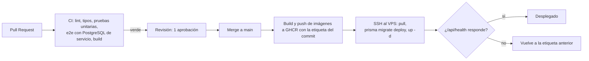

# DevOps y despliegue

## Entornos

| Entorno | Dónde | Cómo se actualiza |
|---|---|---|
| Local | Máquina de cada integrante: PostgreSQL en Docker (`infra/docker-compose.dev.yml`), web y api con `pnpm dev` | Manual |
| Producción | VPS con Docker Compose (`infra/docker-compose.yml`) | Automático en cada merge a `main` |

No hay entorno de staging: el CI con base de datos real y la revisión obligatoria cumplen ese papel para un proyecto de este tamaño.

## Servidor

- **Proveedor**: Contabo, plan Cloud VPS 4 (4 vCPU, 8 GB de RAM, 100 GB SSD) en la región EE. UU. Central, contratado el 17 de octubre (issue S0-03). Las opciones gratuitas no cumplían los 2 GB de RAM o no estaban disponibles a tiempo, y este plan da margen de sobra por unos 8 USD al mes con pago mensual.
- **Requisitos mínimos**: 2 GB de RAM, swap de 2 GB, Ubuntu LTS, Docker y el plugin de Compose. El servidor usa Ubuntu 24.04 con 2 GB de swap.
- **Acceso**: SSH solo con llave, se trabaja con el usuario `deploy` (con sudo) y no con root, acceso como root y por contraseña deshabilitados, firewall (`ufw`) con los puertos 22, 80 y 443 (TCP, y UDP para HTTP/3). Cada integrante que necesite entrar recibe su propio usuario y su propia llave.
- **Dominio**: `chatinit.duckdns.org`, un subdominio gratuito de DuckDNS apuntando a la IP fija del VPS. Caddy obtiene y renueva el certificado HTTPS de Let's Encrypt automáticamente. Para cambiar de dominio basta con apuntar el nuevo a la misma IP y actualizar `DOMAIN` en el `.env` del servidor.
- **Archivos en el servidor**: `~/app` contiene `docker-compose.yml`, `Caddyfile`, `backup-db.sh` y el `.env` de producción (permisos 600), que nunca se sube al repositorio.

## Contenedores

| Servicio | Imagen | Puertos expuestos | Notas |
|---|---|---|---|
| caddy | `caddy:2` | 80, 443 (TCP y UDP) | Proxy inverso y HTTPS (`infra/Caddyfile`) |
| web | `ghcr.io/<owner>/<repo>-web:<sha>` | ninguno | Next.js en modo producción |
| api | `ghcr.io/<owner>/<repo>-api:<sha>` | ninguno | NestJS; health check en `/api/health` |
| db | `postgres:16` | **ninguno** | Volumen `pgdata`; Docker abriría el puerto saltándose el firewall |

## Integración y despliegue continuos



`ci.yml` (S0-02), `docs-pdf.yml` y `deploy.yml` (S1-01) están en `.github/workflows/`.

`ci.yml` levanta un PostgreSQL 16 de servicio con la base `minired_test`, aplica las migraciones y corre las e2e contra ella (S1-03). Las e2e vacían las tablas antes de cada prueba y solo aceptan una base cuyo nombre termine en `_test`. Al final construye las imágenes de api y web sin publicarlas, para que un Dockerfile roto falle en el PR y no en el despliegue.

`deploy.yml` corre en cada push a `main`, salvo si solo cambian `docs/`, archivos `.md` o `.claude/`, y también a mano desde la pestaña Actions (`workflow_dispatch`):

1. Construye las imágenes `web` y `api` y las publica en GHCR con la etiqueta del commit y `latest`. Los paquetes de GHCR son públicos, así que el VPS las descarga sin credenciales.
2. Copia `infra/docker-compose.yml`, `infra/Caddyfile`, `infra/deploy.sh` e `infra/backup-db.sh` a `~/app/infra-nuevo` en el VPS. El repositorio es la fuente de verdad: esos archivos no se editan en el servidor.
3. Ejecuta `deploy.sh <sha>`, que copia compose, Caddyfile y `backup-db.sh` a `~/app` (y recarga Caddy si cambió), descarga las imágenes, aplica `prisma migrate deploy` con la CLI que trae la imagen de la api, reinicia los servicios y consulta `/api/health` durante un minuto. Si responde, guarda la etiqueta nueva en `IMAGE_TAG` del `.env`; si no, vuelve a la anterior.

El rollback cambia las imágenes pero **no deshace migraciones**: cada migración tiene que funcionar también con la versión anterior de la api (por ejemplo, agregar una columna con valor por defecto en lugar de renombrarla).

Tampoco restaura `docker-compose.yml` ni `Caddyfile`: `deploy.sh` ya los copió a `~/app` antes de probar la versión nueva. Si un despliegue falla por un cambio en esos archivos, revierte el cambio con un PR a `main` (el siguiente despliegue copia la versión corregida) o, en una emergencia, cópialos a mano desde el último commit bueno al VPS.

**Protección de `main`**: pull request obligatorio, una aprobación, CI en verde y sin excepciones para administradores.

**Secrets de GitHub**: `VPS_HOST`, `VPS_USER`, `VPS_SSH_KEY`. El `.env` de producción vive solo en el VPS.

**Variables de GitHub** (no secretas): `NEXT_PUBLIC_APP_URL` y `NEXT_PUBLIC_CLOUDINARY_CLOUD_NAME`. Se pasan al build de la imagen web porque Next las escribe en el JavaScript al compilar.

## Variables de entorno

| Variable | Usada por | Descripción |
|---|---|---|
| `DOMAIN` | caddy, api, web | Dominio público |
| `GHCR_OWNER`, `REPO_NAME`, `IMAGE_TAG` | compose | Imagen a desplegar |
| `POSTGRES_USER`, `POSTGRES_PASSWORD`, `POSTGRES_DB` | db, api | Credenciales de la base |
| `DATABASE_URL` | api | Cadena de conexión de Prisma |
| `JWT_ACCESS_SECRET`, `JWT_ACCESS_TTL`, `REFRESH_TOKEN_TTL_DAYS` | api | Sesión (RN12) |
| `CORS_ORIGIN` | api | Origen de la web (`https://` + dominio, sin `/` final). Obligatoria desde S1-04: Socket.io solo acepta ese `Origin`. En producción la pone el compose |
| `CLOUDINARY_CLOUD_NAME`, `CLOUDINARY_API_KEY`, `CLOUDINARY_API_SECRET` | api | Subida y borrado de imágenes |
| `API_INTERNAL_URL` | web | URL de la API para el renderizado en servidor |
| `NEXT_PUBLIC_APP_URL`, `NEXT_PUBLIC_CLOUDINARY_CLOUD_NAME` | web (build) | URL pública y nombre de la cuenta de Cloudinary; se fijan al construir la imagen |
| `BACKUP_REMOTE` | backup-db.sh (solo VPS) | Remoto de rclone, cifrado con crypt, donde se copian los respaldos. Vacío: el respaldo se queda en el VPS y el log lo avisa |
| `NEXT_PUBLIC_SOCKET_URL` | web (solo local) | URL de Socket.io. Solo en local (`http://localhost:3000`); en producción queda vacía y el cliente usa el mismo dominio |

La lista completa con valores de ejemplo está en `.env.example`.

## Respaldos

`infra/backup-db.sh` (S2-02) llega a `~/app` con cada despliegue, igual que el compose: se cambia en el repo, nunca en el servidor. Cron lo ejecuta todos los días a las 03:00 UTC (21:00 en Guatemala):

```
0 3 * * * $HOME/app/backup-db.sh >> $HOME/backups/backup.log 2>&1
```

En cada ejecución:

1. Corre `pg_dump -Fc` dentro del contenedor `db`, con la versión de PostgreSQL del servidor y sus propias variables: la contraseña no pasa por el script. El formato custom ya viene comprimido y es el que lee `pg_restore`. `pg_dump` lee una foto consistente de la base sin bloquear a la api.
2. Escribe primero en un archivo `.parcial` y lo lee completo con `pg_restore -f /dev/null`. Solo si se puede leer entero pasa a llamarse `chatinit-AAAAMMDD-HHMMSS.dump` (fecha UTC). Un respaldo cortado nunca entra en la rotación.
3. Si `BACKUP_REMOTE` tiene valor, lo sube con rclone y borra del remoto los que pasen de 7. Si la subida falla, el script termina con error y no borra nada.
4. Deja los 7 más recientes en `~/backups` (permisos 600) y borra los demás.

Cualquier error detiene el script sin rotar nada y queda en `~/backups/backup.log`. Un candado (`flock`) impide dos ejecuciones al mismo tiempo.

**Destino fuera del VPS**: una carpeta de Google Drive de una cuenta del proyecto, con un remoto `crypt` de rclone encima. rclone cifra el contenido y los nombres antes de subirlos, así que en Drive solo se ven archivos ilegibles. La contraseña y la sal del `crypt` se guardan en el gestor de contraseñas del equipo: sin ellas no se puede restaurar ningún respaldo. El cifrado protege contra una filtración de la cuenta de Drive, no contra alguien que entre al VPS, porque la configuración de rclone vive allí (`~/.config/rclone/rclone.conf`, permisos 600).

rclone se instala en el VPS, no en el repositorio. Para traer un respaldo a otra máquina hace falta el mismo remoto `crypt` configurado con esa contraseña y `rclone copy respaldos-cifrados:chatinit/<archivo> .`. En la semana 4 se restaura el último respaldo en una base limpia para comprobar que sirve (issue S4-03).

**Probar un cambio al script en local**, con la base de desarrollo encendida y rclone instalado. El remoto `:local:` de rclone es una carpeta normal y no necesita configuración:

```bash
APP_DIR=$PWD/infra COMPOSE_FILE=docker-compose.dev.yml BACKUP_DIR=/tmp/resp \
  BACKUP_REMOTE=:local:/tmp/resp-remoto bash infra/backup-db.sh
```

## Observabilidad

- `apps/api/scripts/probar-socket.mjs` comprueba el socket a través de Caddy después de un despliegue: inicia sesión con una cuenta de prueba y revisa que llegue `session:ready` y que se rechacen la conexión sin cookie y la de otro `Origin` (S1-04). El uso está en el comentario del archivo.
- `GET /api/health` informa el estado de la API y de la conexión a PostgreSQL; el pipeline lo usa para decidir si el despliegue fue correcto.
- Logs en formato JSON por salida estándar, consultables con `docker compose logs -f api`.
- Monitoreo externo opcional con un servicio gratuito de uptime apuntando a `/api/health`.
