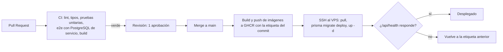

# DevOps y despliegue

## Entornos

| Entorno | Dónde | Cómo se actualiza |
|---|---|---|
| Local | Máquina de cada integrante: PostgreSQL en Docker (`infra/docker-compose.dev.yml`), web y api con `pnpm dev` | Manual |
| Producción | VPS con Docker Compose (`infra/docker-compose.yml`) | Automático en cada merge a `main` |

No hay entorno de staging: el CI con base de datos real y la revisión obligatoria cumplen ese papel para un proyecto de este tamaño.

## Servidor

- **Proveedor**: primero se intentan las opciones gratuitas (GitHub Student Pack, Azure for Students, Oracle Always Free). Si al 16 de octubre (día 3) no hay una máquina funcionando, se contrata un VPS económico (issue S0-03).
- **Requisitos mínimos**: 2 GB de RAM, swap de 2 GB, Ubuntu LTS, Docker y el plugin de Compose.
- **Acceso**: SSH solo con llave, usuario `deploy` sin privilegios de root, firewall con los puertos 22, 80 y 443.
- **Dominio**: un único dominio o subdominio apuntando a la IP del VPS. Caddy obtiene y renueva el certificado HTTPS automáticamente.

## Contenedores

| Servicio | Imagen | Puertos expuestos | Notas |
|---|---|---|---|
| caddy | `caddy:2` | 80, 443 | Proxy inverso y HTTPS (`infra/Caddyfile`) |
| web | `ghcr.io/<owner>/<repo>-web:<sha>` | ninguno | Next.js en modo producción |
| api | `ghcr.io/<owner>/<repo>-api:<sha>` | ninguno | NestJS; health check en `/api/health` |
| db | `postgres:16` | **ninguno** | Volumen `pgdata`; Docker abriría el puerto saltándose el firewall |

## Integración y despliegue continuos

Los workflows parten de las plantillas `infra/plantillas/ci.yml` y `infra/plantillas/deploy.yml`, que se mueven a `.github/workflows/` en las issues S0-02 y S1-01. El workflow `docs-pdf.yml` ya está activo y genera el PDF de esta documentación.

**Protección de `main`**: pull request obligatorio, una aprobación, CI en verde y sin excepciones para administradores.

**Secrets de GitHub**: `VPS_HOST`, `VPS_USER`, `VPS_SSH_KEY`. El `.env` de producción vive solo en el VPS.

## Variables de entorno

| Variable | Usada por | Descripción |
|---|---|---|
| `DOMAIN` | caddy, api, web | Dominio público |
| `GHCR_OWNER`, `REPO_NAME`, `IMAGE_TAG` | compose | Imagen a desplegar |
| `POSTGRES_USER`, `POSTGRES_PASSWORD`, `POSTGRES_DB` | db, api | Credenciales de la base |
| `DATABASE_URL` | api | Cadena de conexión de Prisma |
| `JWT_ACCESS_SECRET`, `JWT_ACCESS_TTL`, `REFRESH_TOKEN_TTL_DAYS` | api | Sesión (RN12) |
| `CORS_ORIGIN` | api | Origen permitido |
| `CLOUDINARY_CLOUD_NAME`, `CLOUDINARY_API_KEY`, `CLOUDINARY_API_SECRET` | api | Subida y borrado de imágenes |
| `API_INTERNAL_URL` | web | URL de la API para el renderizado en servidor |
| `NEXT_PUBLIC_APP_URL`, `NEXT_PUBLIC_CLOUDINARY_CLOUD_NAME` | web | URL pública y nombre de la cuenta de Cloudinary |

La lista completa con valores de ejemplo está en `.env.example`.

## Respaldos

`scripts/backup-db.sh` ejecuta `pg_dump` todos los días a las 03:00 UTC por cron, conserva los últimos 7 respaldos y los copia fuera del VPS. En la semana 4 se restaura el último respaldo en una base limpia para comprobar que sirve (issue S4-03).

## Observabilidad

- `GET /api/health` informa el estado de la API y de la conexión a PostgreSQL; el pipeline lo usa para decidir si el despliegue fue correcto.
- Logs en formato JSON por salida estándar, consultables con `docker compose logs -f api`.
- Monitoreo externo opcional con un servicio gratuito de uptime apuntando a `/api/health`.
